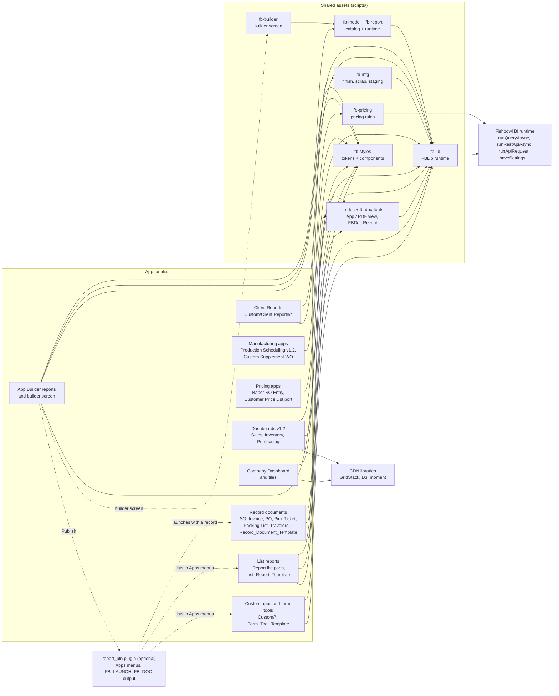

# Fishbowl BI Reports

Apps and reports for Fishbowl Advanced's BI Reports module. Each one is a
single HTML file. It runs in the client's embedded Chromium browser
(JxBrowser) and reads Fishbowl data through built-in JavaScript functions
such as `runQueryAsync`, `runRestApiAsync`, `runApiRequest` and
`saveSettings`. [CLAUDE.md](CLAUDE.md) documents the full API and the repo's
working rules.

**Every app runs standalone in the plain BI Reports viewer.** The report_btn
client plugin (Apps menus in each module, opening a report on the module's
record, document output) is an optional extra a page uses when it is present.

## Start here

1. Read this page, then [docs/building-apps.md](docs/building-apps.md): the
   templates, the shared libraries, printing, identity and deploying.
2. Pick the closest template in [`Template/`](Template/) (list report, record
   document or form tool) or the closest existing app below, and copy it.
3. Look up tables in [schema/schema-index.md](schema/schema-index.md) before
   writing SQL.
4. Run it in the BI Script Editor, or outside Fishbowl on recorded data with
   [tools/report-harness](tools/report-harness/README.md).
5. Deploy the shared assets first, then the report
   ([scripts/README.md](scripts/README.md), [tools/deploy/README.md](tools/deploy/README.md)).

Porting a stock iReport (.jrxml)? Read [docs/porting-ireport.md](docs/porting-ireport.md).
Claude Code skills in `.claude/skills/` walk through the common jobs:
`create-bi-app`, `port-ireport-report`, `add-printable-view`,
`extend-app-builder-model`, `fishbowl-bi-save-error`.

## Folders

| Folder | Contents |
|---|---|
| [`iReport_Ports/`](iReport_Ports/README.md) | BI versions of the stock iReport reports and paperwork, in the same folders as the originals. Every deviation is in [DIFFERENCES.md](iReport_Ports/DIFFERENCES.md) |
| [`Dashboards/`](Dashboards/dashboards.md) | Sales, Inventory and Purchasing dashboards (v1.2); Company Dashboard and its eight tiles in `Individual Pages/` |
| `Custom/` | Generic custom apps, by module: `Audit`, `Customer`, `Inventory`, `Manufacturing`, `Part`, `Product`, `PurchaseOrder`, `Receiving`, `SalesOrder` |
| `Custom/Client Reports/` | Client-specific apps: `Babor`, `BrightSteel`, `Infinit_Nutrition`, `Malmet`, `TKMS` |
| [`Template/`](Template/) | Starting points: a list report, a record document, a form tool |
| [`scripts/`](scripts/README.md) | The shared assets every app includes (below) |
| [`schema/`](schema/schema-index.md) | Database schema reference |
| [`docs/`](docs/README.md) | Developer guides |
| [`tools/`](tools/) | Active developer tooling: build stamping, deploying and publishing, the report harness, test suites |

Not production:

- `archived/`: superseded versions, the legacy theme CSS and design mockups, kept for comparison (see its README).
- `Custom/Manufacturing/Archived/` and `Custom/Manufacturing/Temp/`:
  earlier Production Scheduling and Gantt versions.
- `Other_NOT_FOR_PRODUCTION/`: the report_btn plugin, the App Builder screen,
  the App Library, the Power BI agent, helper tools, prototypes and sample data (see its README).

## How the pieces fit

Apps include shared Script and Style records by name; Fishbowl pastes each one
into the page. Arrows read "uses".



| Family | Where | Includes | Notes |
|---|---|---|---|
| List reports | `iReport_Ports/*`, `Template/List_Report_Template.htm` | fb-styles, fb-lib, fb-doc, fb-doc-fonts | Report chrome, company defaults, RowCap / RptCols / Pivot, .xlsx, PDF view |
| Record documents | `iReport_Ports/SalesOrder`, `Ship`, `PurchaseOrder`, `Picking`, `WorkOrder`, `ManufactureOrder`… | the same | One record at a time through `FBDoc.Record`: picker, launch lock, document output. Only these keep an Apps-menu tag |
| Custom apps | `Custom/*` | fb-styles, fb-lib (a few older ones include nothing) | Workflow tools; writes go through REST or `runApiRequest` with confirm and verify |
| Manufacturing | `Custom/Manufacturing`, Custom Supplement WO | + fb-mfg | fb-mfg is generated from `Production_Scheduling_v1.2.htm` |
| Pricing | Babor SO Entry, Customer Price List | + fb-pricing | QuickOrder carries its own inline copy |
| Client reports | `Custom/Client Reports/*` | fb-styles, fb-lib | One client each; same rules as Custom apps |
| Dashboards v1.2 | `Dashboards/*_v1.2.htm` | fb-styles, fb-lib + CDN | Independent family ([review](docs/dashboards-review.md)) |
| Company Dashboard + tiles | `Dashboards/Dashboard_Combined.htm`, `Individual Pages/` | fb-lib + CDN moment | Published to SharePoint too |
| App Builder | builder: `Other_NOT_FOR_PRODUCTION/Report_Builder`; its reports in Fishbowl | fb-model, fb-report (+ fb-builder for the screen) | The report's SQL is compiled at run time ([guide](docs/app-builder-models.md)) |

Deploy order follows the arrows backwards: fb-styles, fb-lib, fb-doc and
fb-doc-fonts, then fb-mfg / fb-pricing / fb-model, fb-report, fb-builder, then
the apps.

## Report identity and versions

Every production report opens its `<head>` with its folder, an optional
system-app marker, a one-line description and:

```js
window.FB_REPORT = { key: 'cdx.bi.…', name: 'Report Name', build: '2026.09.30-4ca940a' };
```

| Field | What it is |
|---|---|
| `key` | Prefix for everything the report stores (settings, saved views, shared data). |
| `name` | The Fishbowl record name. Deploying and publishing find the record by it, so renaming creates a duplicate. `null` means the report isn't published. |
| `build` | The date the content last changed plus a content hash. Written by `tools/stamp/stamp.js`; never edit it by hand. |

The shared assets carry their own stamps (`FBLib.BUILD`, `FBDoc.BUILD`,
`FBMfg.BUILD`, `--fb-styles-build`). File-name suffixes such as `_v1.2` mark
major rewrites; the record `name` is what identifies a report.

## Setup

```sh
git config core.hooksPath tools/githooks   # pre-commit build stamping, once per clone
```

- **Node.** The stamp, deploy and publish tools use only Node built-ins. Some
  test harnesses (`tools/custom-supplement-tests`, `tools/report-harness`)
  need `npm install` or a local Chrome.
- **Deploying to Fishbowl.** `tools/deploy/fishbowl.local.json` (gitignored)
  holds the server and login; without it, deploying does nothing.
- **Publishing to SharePoint.** `tools/deploy/publish.local.json` (gitignored)
  holds the synced folder as `{ "dir": "<path>" }`, or set `FB_PUBLISH_DIR`.

| Command | What it does |
|---|---|
| `node tools/stamp/stamp.js [--check \| --list]` | Stamp or verify build stamps |
| `node tools/deploy/targets.js <fishbowl\|sharepoint\|both\|none> "<file>"` | Choose where a file's edits go |
| `node tools/deploy/fbdeploy.js "<file>" [--status \| --dry]` | Write a report to the local Fishbowl server |
| `node tools/deploy/publish.js "<file>" [--list \| --dry]` | Update a report's export in the SharePoint folder |
| `node tools/deploy/build-deployed.js` | Build importable JSON exports into the gitignored `Deployed/` (on request only) |

## Read next

- [CLAUDE.md](CLAUDE.md): the BI JavaScript API, runtime constraints and
  conventions.
- [docs/](docs/README.md): building apps, porting iReports, fb-doc, the App
  Builder, the launch contract, the dashboards review.
- [scripts/README.md](scripts/README.md): every shared asset, its record and
  the deploy order.
- [tools/deploy/README.md](tools/deploy/README.md): deploying and publishing.
- [LICENSES.md](LICENSES.md): third-party licences.
